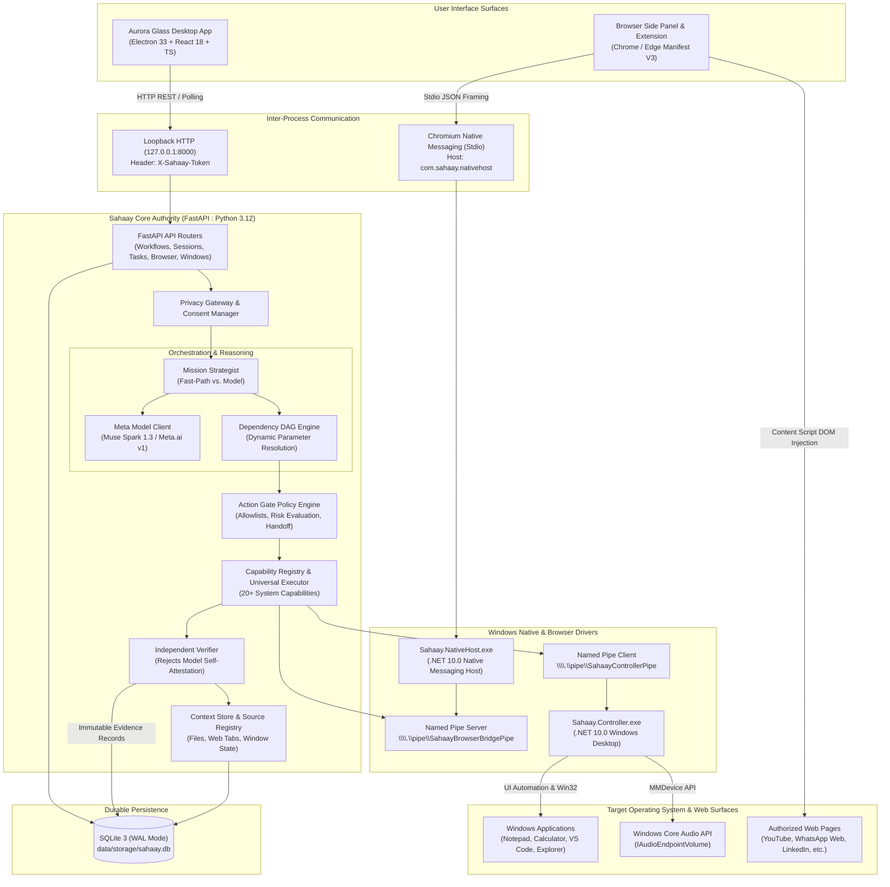
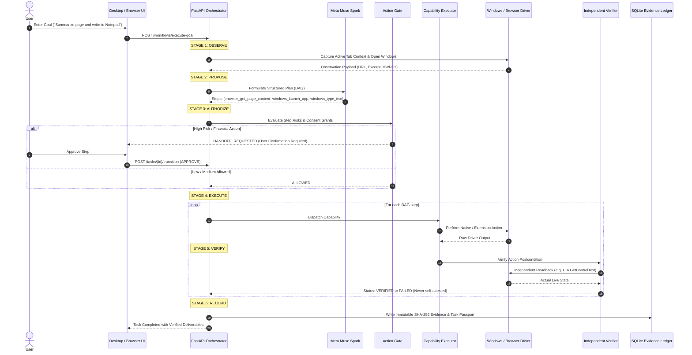

# Sahaay (ಸಹಾಯ / Sahaay)
### *A Privacy-Aware, Voice-First Windows AI Agent Engineered for Truthful Information Retrieval & Verified Computer Actions*

[](https://github.com/VishwanathArchakMR/Sahaay/actions/workflows/ci.yml)
[](https://fastapi.tiangolo.com)
[](https://ai.meta.com)
[](https://dotnet.microsoft.com)
[](https://www.electronjs.org/)
[](#19-contribution-license-and-acknowledgments)

---

## Table of Contents
- [1. Project Identity & Introduction](#1-project-identity--introduction)
- [2. Project Overview](#2-project-overview)
- [3. Key Capabilities & Feature Inventory](#3-key-capabilities--feature-inventory)
- [4. System Architecture](#4-system-architecture)
- [5. Task Execution Lifecycle & Verification State Machine](#5-task-execution-lifecycle--verification-state-machine)
- [6. Meta AI Integration](#6-meta-ai-integration)
- [7. Privacy, Security & Boundary Enforcement](#7-privacy-security--boundary-enforcement)
- [8. Technology Stack](#8-technology-stack)
- [9. Repository Structure](#9-repository-structure)
- [10. Installation & Setup Guide](#10-installation--setup-guide)
- [11. Configuration Reference](#11-configuration-reference)
- [12. Running & Using Sahaay](#12-running--using-sahaay)
- [13. API Reference](#13-api-reference)
- [14. Testing & Quality Assurance](#14-testing--quality-assurance)
- [15. Demo Walkthrough](#15-demo-walkthrough)
- [16. Meta AI Developer Hackathon — Project Story](#16-meta-ai-developer-hackathon--project-story)
- [17. Current Implementation Status & Known Limitations](#17-current-implementation-status--known-limitations)
- [18. Project Roadmap](#18-project-roadmap)
- [19. Contribution, License, and Acknowledgments](#19-contribution-license-and-acknowledgments)

---

## 1. Project Identity & Introduction

**Sahaay** (derived from the Sanskrit and Kannada word **ಸಹಾಯ**, meaning *assistance* or *support*) is a native Windows AI computer agent designed to bridge conversational intelligence with actual operating-system and browser execution.

### The Fundamental Difference: Chatbots vs. Computer Agents
Most current AI assistants are conversational chatbots trapped in a web browser tab or sandboxed mobile window. When asked to perform computer work—such as opening an application, summarizing local files, transferring an invoice total into accounting software, or finding a video—traditional LLMs merely generate text describing how a human might do it, or hallucinate completion without verifying that any action occurred.

Sahaay is architected from the ground up as a **truthful computer intelligence agent**:
1. **Physical Environment Interaction:** It observes real Windows application windows through Microsoft UI Automation (UIA) and inspects live web tabs through a Manifest V3 browser extension.
2. **Action Execution:** It dispatches concrete, bounded operations (opening windows, setting control text, navigating pages, typing into message composers, adjusting volume) through a native .NET 10 controller.
3. **Independent Verification:** It rejects model self-attestation. A task is never reported as successful simply because an LLM said "I have done that." The system performs an independent readback of the resulting state and records immutable cryptographic evidence in an SQLite ledger.

### Intended Users & Accessibility Focus
Sahaay is designed for users who want natural, hands-free computer interaction—including busy professionals managing complex desktop workflows, non-technical users navigating Windows settings, and individuals requiring accessible, voice-first computing in English and Indian languages (Kannada, Hindi).

---

## 2. Project Overview

### The Problem
- **Siloed Context:** AI models do not know what is on your screen, which tabs you have open, or where your documents are stored unless manually copy-pasted.
- **Hallucinated Execution:** Conventional agents frequently return "Task complete!" when the underlying driver failed, timed out, or never ran.
- **Privacy Leakage:** Standard cloud assistants transmit entire screen buffers, conversation histories, and private documents to third-party endpoints without redaction or explicit user consent.
- **Uncontrolled Autonomy:** Blindly giving LLMs raw terminal execution (`cmd.exe`, `powershell.exe`) introduces severe system security risks.

### Sahaay's Approach
- **Deterministic Action Gate:** All agent actions must pass through an authoritative policy gate that permanently blocks raw shell execution and requires explicit human confirmation for consequential actions (such as e-commerce checkout or file deletion).
- **Dual-Interface Experience:**
  - **Aurora Glass Desktop Workspace:** An Electron + React application featuring dual operational modes: **Automate** (interactive DAG task execution, live task inspector, lifecycle stages, and verification passports) and **Help** (a conversational ChatGPT-style guide with continuous shared history).
  - **Chrome & Edge Manifest V3 Browser Side Panel:** A persistent browser copilot that observes active tabs, extracts page content, navigates URLs, and coordinates bidirectional transfers to desktop applications via Chromium Native Messaging.
- **Fail-Closed Privacy Gateway:** A local-first proxy that redacts credentials, enforces granular user consent, and offers a strict **Local-Only Mode** where external cloud inference is completely disabled.

---

## 3. Key Capabilities & Feature Inventory

Every capability in Sahaay is categorized by its verified runtime status:

| Capability | Scope / Surface | Runtime Status | Implementation Details |
|---|---|---|---|
| **Autonomous Mission Planning** | Meta Muse Spark (`muse-spark-1.3`) | **Implemented** *(Config-Dependent)* | Multi-turn function calling, dependency DAG decomposition, dynamic parameter resolution. Falls back to offline grounded planner when unconfigured. |
| **Conversational Help Mode** | Desktop Renderer + `/sessions/{id}/chat` | **Implemented** | Dedicated ChatGPT-style conversational assistant with typing indicator, shared SQLite history, and local fallback guide. |
| **Windows UI Automation** | .NET 10 Companion (`Sahaay.Controller`) | **Implemented** | Inspects desktop controls, sets text in Notepad editor, reads Calculator results, captures window screenshots via GDI/UIA. |
| **Windows Application Launching** | Native Controller + `APP_PROCESS_PATTERNS` | **Implemented** | Discovers and launches registered applications (`notepad`, `calc`, `code`/VS Code, `explorer`, `chrome`, `msedge`, `wt`). |
| **System Volume Control** | Native Controller (`IAudioEndpointVolume`) | **Implemented** | Sets master system volume (0–100%) and returns verified post-change audio level. |
| **Browser Tab Navigation & Grounding** | Chromium MV3 Extension (`service-worker`) | **Implemented** | Creates new tabs, updates existing tabs, and navigates blank tabs (`chrome://newtab/`) to target URLs. |
| **Browser DOM Observation** | Content Script (`get_tab_observation`) | **Implemented** | Extracts page title, URL, dimensions, scroll position, and sanitized interactive elements (links, buttons, inputs). |
| **Targeted Privacy Extraction** | WhatsApp Web & LinkedIn | **Implemented** | Minimizes extracted data: observes only active chat headers and composer readiness; strictly blocks dumping bulk chat history or payment data. |
| **Web Textfield & Composer Typing** | Extension Content Script (`input_text`) | **Implemented** | Types text into modern `contenteditable` chat composers (WhatsApp, LinkedIn) and standard `<input>`/`<textarea>` elements. |
| **Web Media Playback** | Extension Content Script (`play_media`) | **Implemented** | Automates YouTube / HTML5 video playback and verifies active player state (`PLAYING`, `BUFFERING`). |
| **Document Ingestion & Chunking** | Python Core (`pypdf` + `DocumentService`) | **Implemented** | Ingests PDF and text files, calculates SHA-256 fingerprints, segments text into chunks, records facts into ContextStore. |
| **Web Research** | DuckDuckGo API (`ddgs`) + HTTP Scraper | **Implemented** | Bounded internet queries, link extraction, HTML-to-text sanitization (max 2 MB per page, 5 results). |
| **Independent Verification** | Verification Engine (`IndependentVerifier`) | **Implemented** | Verifies pre/postconditions; strictly rejects model self-attestation; fails steps without verified proof. |
| **Cryptographic Evidence Ledger** | SQLite WAL Storage (`evidence_records`) | **Implemented** | Records immutable evidence hashes linking user goals, actions, verification outcomes, and driver provenance. |
| **Task Passport & Audit Provenance** | Backend Router (`/tasks/{id}/passport`) | **Implemented** | Generates auditable digital passport detailing goal, surface, verification status, deliverables, and milestone timing. |
| **Voice Microphone Pipeline** | Desktop Web Audio API + Muse Voice | **Implemented** *(Config-Dependent)* | Captures 16 kHz mono 16-bit PCM WAV audio. Transcribes via Meta Voice API; normalizes WAV headers locally. |
| **Visual Grounding & Segmentation** | Meta SAM 3.1 (`sam-3.1`) & Muse Wonder | **Partially Implemented** | Client classes exist; visual wonder escalation triggers on execution failure; falls back to Win32 UIA bounds. |
| **Local Llama Inference** | `llama.cpp` HTTP API (`LocalLlamaClient`) | **Experimental** | Client implementation for port 8080 exists; requires user-supplied GGUF model and server. |
| **Visual Storytelling Illustrations** | Meta Muse Image (`muse-image-1.0`) | **Experimental** | Generates SVG/PNG task illustrations; falls back to deterministic local SVG generator when unconfigured. |

---

## 4. System Architecture

Sahaay employs a distributed, process-isolated architecture communicating via loopback HTTP, standard I/O (Chromium Native Messaging), and Windows Named Pipes.



### Component Responsibilities

1. **Aurora Glass Desktop (`apps/desktop`):**
   - Built with Electron 33, React 18, Vite, and Lucide React.
   - Operates in strict isolation: `contextIsolation: true`, `nodeIntegration: false`, communicating exclusively via authenticated loopback HTTP to `127.0.0.1:8000`.
   - Offers dual user modes:
     - **Automate Mode:** Full task lifecycle management, live execution inspector, step-by-step DAG view, verification results, and historical task records.
     - **Help Mode:** Conversational assistant for software guidance, general questions, and step-by-step help, without triggering operational tasks or UI clutter.
2. **FastAPI Core Backend (`core/src/sahaay_core`):**
   - Authoritative central orchestrator running on Python 3.12.
   - Manages task state machines, model routing, DAG dependency execution, and source references.
   - Enforces the `ActionGate` allowlist and verifies all step postconditions.
3. **Browser Extension (`apps/browser-extension`):**
   - Manifest V3 extension for Chrome and Edge.
   - Injects sandboxed content scripts to capture DOM structure, interact with form controls, type into `contenteditable` composers, and control media playback.
   - Communicates with the local system via Chromium Native Messaging (`com.sahaay.nativehost`).
4. **.NET 10 Windows Companion (`apps/windows-companion`):**
   - Native C# .NET 10 solution comprising `Sahaay.Controller`, `Sahaay.NativeHost`, and `Sahaay.Contracts`.
   - Directly interfaces with Windows UI Automation (UIA) to discover windows, set/read control text, capture screenshots, and query system volume without simulated mouse clicks.

---

## 5. Task Execution Lifecycle & Verification State Machine

Every user automation request adheres to an immutable 6-stage lifecycle:

$$\mathbf{OBSERVE} \longrightarrow \mathbf{PROPOSE} \longrightarrow \mathbf{AUTHORIZE} \longrightarrow \mathbf{EXECUTE} \longrightarrow \mathbf{VERIFY} \longrightarrow \mathbf{RECORD}$$



### Lifecycle Stage Invariants

1. **OBSERVE:** The system inspects the external desktop and browser environment. If a goal references an application or tab that is not active, the system checks whether launching it is authorized.
2. **PROPOSE:** Meta Muse Spark (or the deterministic fast-path planner) decomposes the goal into a dependency-ordered directed acyclic graph (DAG) of capability steps.
3. **AUTHORIZE:** The `ActionGate` inspects every proposed step:
   - Shell commands (`cmd.exe`, `powershell.exe`) are permanently denied.
   - Out-of-scope files or processes are rejected.
   - Consequential actions (e.g., e-commerce order placement, payments, irreversible edits) transition the task to `HANDOFF_REQUESTED`, pausing execution until the user explicitly approves.
4. **EXECUTE:** The `CapabilityExecutor` invokes the underlying native driver (.NET controller or browser extension).
5. **VERIFY:** The `IndependentVerifier` checks whether the postcondition actually occurred (e.g., verifying that Notepad contains the exact text written, or that a YouTube player has transitioned to `PLAYING`). If the driver returns failure or the readback does not match, the step is marked `FAILED`—false completion is strictly prevented.
6. **RECORD:** All facts, step results, duration metrics, and SHA-256 evidence hashes are committed to SQLite. A `TaskPassport` is generated and returned to the UI.

---

## 6. Meta AI Integration

Meta AI models serve as the cognitive reasoning backbone for complex mission planning, multimodal screen understanding, and multilingual voice interaction.

### Model-Role & Implementation Status Matrix

| Meta Model | Model ID | Canonical Role | API Endpoint | Fallback Behavior | Implementation Status |
|---|---|---|---|---|---|
| **Meta Muse Spark** | `muse-spark-1.3` | Multi-turn reasoning, tool calling, dependency DAG decomposition, multilingual intent recognition (Kannada, Hindi, English). | `POST /chat/completions` | Deterministic offline DAG planner using grounded system capabilities. | **Implemented & Integrated** *(Requires `MODEL_API_KEY`)* |
| **Meta Muse Voice** | `muse-voice-transcribe-1.0` | 16 kHz PCM WAV spoken voice transcription with Indian language hints. | `POST /audio/transcriptions` | Fails closed with privacy-preserving error; requests typed input. | **Implemented & Integrated** *(Requires `MODEL_API_KEY`)* |
| **Meta Muse Wonder** | `muse-wonder-1.0` | Visual desktop reasoning and screenshot analysis during failure escalation. | `POST /chat/completions` *(multimodal)* | UI Automation accessible control element discovery via Windows controller. | **Implemented & Integrated** *(Requires `MODEL_API_KEY`)* |
| **Meta SAM 3.1** | `sam-3.1` | High-fidelity bounding box segmentation and visual screen grounding. | `POST /chat/completions` | Standard Win32 bounding rectangles from UIA element trees. | **Partially Implemented** *(Client exists; fallback active)* |
| **Meta Muse Image** | `muse-image-1.0` | Visual storytelling illustrations for Task Passports. | `POST /images/generations` | Local deterministic procedural SVG generator (zero network calls). | **Experimental** *(SVG fallback fully operational)* |

### How Meta API Calls Work
- **Base URL:** `https://api.meta.ai/v1` (configured via `META_API_BASE_URL`).
- **Transport Security:** HTTP/2 client (`httpx`) with strict TLS verification using `certifi` bundles and the Windows root certificate store (`wincertstore`).
- **Resilience:** Bounded exponential backoff with jitter (up to 3 retries) and granular error classification:
  - `ModelProviderNotConfiguredError`: API key missing; activates offline fallback immediately without latency.
  - `ModelProviderAuthenticationError`: Invalid credential; logs sanitized error without leaking bearer tokens.
  - `ModelProviderRateLimitError` / `ModelProviderTimeoutError`: Handles transient outages gracefully.
- **Fail-Closed Privacy Gateway:** If `SAHAAY_PRIVACY_LOCAL_ONLY_MODE=true` or user consent is not granted, requests to Meta Cloud are blocked at the application layer before any network socket is opened.

---

## 7. Privacy, Security & Boundary Enforcement

Sahaay was designed for privacy-sensitive Windows environments. It treats every external model, web page, and script as untrusted.

### Security Architecture Principles

1. **Loopback-Only Network Binding:**
   - The FastAPI backend binds strictly to `127.0.0.1:8000`. It does not listen on `0.0.0.0` or expose any port to the local area network.
   - All desktop-to-backend requests require the `X-Sahaay-Token` header, validated against an in-memory secret generated on launch.
2. **Process Isolation & Named Pipes:**
   - The Electron desktop app runs with `contextIsolation: true` and `nodeIntegration: false`. It cannot spawn arbitrary OS processes.
   - The backend communicates with the .NET Windows Controller over a local Windows Named Pipe (`\\.\pipe\SahaayControllerPipe`), restricting access to the interactive desktop session.
3. **Chromium Native Messaging Sandbox:**
   - The browser extension communicates via Chromium Stdio Native Messaging (`com.sahaay.nativehost`). The extension never has direct access to the Windows API, file system, or arbitrary named pipes.
4. **Permanent Shell Execution Ban:**
   - The `ActionGate` enforces a strict allowlist. Any tool proposal attempting to run `cmd.exe`, `powershell.exe`, `bash.exe`, `wscript.exe`, or raw command strings is rejected and flagged as a security violation.
5. **Consequential Action Gates & User Handoff:**
   - Financial checkout pages, sensitive credential forms, and file deletion operations cannot be executed autonomously. The system halts at `HANDOFF_REQUESTED` and alerts the user to complete the action manually.
6. **Data Minimization on Messaging Platforms:**
   - When inspecting pages like **WhatsApp Web** (`web.whatsapp.com`) or **LinkedIn** (`linkedin.com`), the content script specifically targets the active conversation contact header, composer readiness, and at most the last 2 messages. It strictly refrains from dumping the entire DOM text, preventing contact lists, transaction history, or private chats from entering model prompts.
7. **Local-Only Mode:**
   - Setting `SAHAAY_PRIVACY_LOCAL_ONLY_MODE=true` disables all outbound HTTP requests to Meta Cloud. All tasks are resolved via local heuristics, deterministic capability dispatch, and local SQLite data.

---

## 8. Technology Stack

All versions are derived directly from repository manifests (`pyproject.toml`, `package.json`, `.csproj`):

| Layer | Technology | Version | Purpose in Sahaay |
|---|---|---|---|
| **Backend Runtime** | Python | `>= 3.12` (Tested on 3.12.8) | Core authority, orchestration, and API services |
| **API Framework** | FastAPI | `>= 0.115.0` | High-performance asynchronous REST API |
| **ASGI Server** | Uvicorn | `>= 0.30.0` | Production async server with standard loopback bindings |
| **Data Validation** | Pydantic / Pydantic Settings | `>= 2.8.0` / `>= 2.4.0` | Request/response contracts, settings management |
| **Persistence** | SQLite 3 + aiosqlite | `>= 0.20.0` (WAL Mode) | Relational state, evidence ledger, session history |
| **ORM / Async DB** | SQLAlchemy | `>= 2.0.30` | Async database engine and session management |
| **HTTP Client** | HTTPX | `>= 0.27.0` | Meta AI API transport with HTTP/2 and custom SSL contexts |
| **PDF Processing** | pypdf | `>= 5.0.0` | Local document ingestion and text extraction |
| **Web Search** | ddgs (DuckDuckGo Search) | `>= 9.0.0` | Clean web search without API keys |
| **Desktop Shell** | Electron | `^33.0.1` | Native Windows desktop wrapper with secure preload |
| **Frontend UI** | React | `^18.3.1` | Interactive desktop interface with state management |
| **Language** | TypeScript | `^5.5.4` | Strict type safety across desktop and browser extension |
| **Bundler** | Vite | `^5.4.8` | Ultra-fast desktop renderer bundler |
| **Icons** | Lucide React | `^0.453.0` | Crisp modern vector iconography |
| **Windows Runtime** | Microsoft .NET SDK | `10.0` (`net10.0-windows`) | High-performance native Windows companion |
| **Desktop Automation** | UI Automation (UIA) | Windows 10/11 Win32 API | Native element inspection, window handling, and control readback |
| **Browser Platform** | Chromium Extensions API | Manifest V3 (MV3) | Side panel, content scripts, and native messaging bridge |
| **Python Build System** | Hatchling / uv | Latest | Fast Python package management and virtual environment tooling |
| **Code Quality** | Ruff / Pytest | `^0.5.0` / `9.1.1` | Fast linting, formatting, and unit testing |

---

## 9. Repository Structure

```text
Sahaay/
├── .github/
│   └── workflows/
│       └── ci.yml                     # GitHub Actions CI workflow (Windows runner)
├── apps/
│   ├── browser-extension/             # Chrome & Edge Manifest V3 Browser Extension
│   │   ├── manifest.json              # MV3 configuration & permissions
│   │   ├── package.json               # Extension dependencies (@types/chrome, typescript)
│   │   ├── scripts/package.mjs        # Packaging script copying files to dist/
│   │   └── src/
│   │       ├── content/index.ts       # DOM inspection, input_text, media playback
│   │       ├── service-worker/index.ts# Native host bridge & tab navigation coordinator
│   │       └── sidepanel/             # Browser side panel user interface
│   ├── desktop/                       # Electron 33 + React 18 Desktop Application
│   │   ├── package.json               # Electron, React, Vite dependencies
│   │   ├── src/
│   │   │   ├── main/index.ts          # Electron main process (IPC, window lifecycle)
│   │   │   ├── preload/index.ts       # Secure context bridge
│   │   │   └── renderer/src/
│   │   │       ├── App.tsx            # Main Aurora Glass UI (Automate vs. Help modes)
│   │   │       └── main.tsx           # React DOM root entry
│   │   └── vite.config.ts             # Vite build configuration
│   └── windows-companion/             # .NET 10 Native Windows Companion Solution
│       ├── Sahaay.sln                 # Visual Studio .NET 10 solution file
│       ├── Sahaay.Contracts/          # Shared IPC command/response models
│       ├── Sahaay.Controller/         # Named Pipe server, UI Automation, Win32 audio
│       ├── Sahaay.NativeHost/         # Chromium Native Messaging Host binary
│       └── tests/                     # xUnit tests for controller and native host
├── core/                              # Sahaay Core Backend (Python 3.12 package)
│   ├── pyproject.toml                 # Package definition & dependencies
│   └── src/sahaay_core/
│       ├── adapters/                  # Hardware & surface adapters
│       │   ├── browser/adapter.py     # Browser bridge & launcher fallback
│       │   └── windows/adapter.py     # Windows named pipe client & UIA fallback
│       ├── api/v1/                    # FastAPI route handlers
│       │   ├── actions.py             # Action execution & evidence ledger API
│       │   ├── browser.py             # Browser tab observation & action API
│       │   ├── health.py              # System health & component diagnostics
│       │   ├── models.py              # Meta model connectivity & telemetry
│       │   ├── sessions.py            # Session management & ChatGPT-style Help chat
│       │   ├── tasks.py               # Task lifecycle & Task Passport API
│       │   ├── windows.py             # Windows application & volume control API
│       │   └── workflows.py           # Unified execute-goal & mission orchestration
│       ├── capabilities/              # Capability registry, executor, code runner
│       ├── config/                    # Pydantic settings & logging configuration
│       ├── context/                   # Context store & fact derivation chains
│       ├── contracts/                 # Pydantic data models & consent purposes
│       ├── models/                    # Meta model API clients (Spark, Wonder, Voice, SAM)
│       ├── orchestration/             # DAG execution engine & mission strategist
│       ├── perception/                # Target window resolver & observation coordinator
│       ├── policy/                    # Action Gate security policy engine
│       ├── retrieval/                 # Scoped retrieval across local sources
│       ├── sources/                   # PDF document ingestion & workspace indexing
│       ├── storage/                   # SQLite schema, durable persistence, migrations
│       └── verification/              # Independent verifier (readback checks)
├── data/
│   ├── fixtures/                      # Sample invoices & test documents
│   └── storage/                       # Local SQLite database (sahaay.db)
├── scripts/
│   ├── build-companion.ps1            # Compiles .NET 10 native companion solution
│   ├── build-extension.ps1            # Compiles and packages browser extension
│   ├── install-browser-native-host.ps1# Registers native messaging host in Windows HKCU
│   ├── run-tests.ps1                  # Runs full automated test suite (Pytest, .NET, TS)
│   ├── setup.ps1                      # Complete repository dependency installation
│   └── start-sahaay.ps1               # Production supervisor launching all subsystems
├── tests/                             # Automated test suite (236 collected tests)
│   ├── browser/                       # Extension contract & CORS tests
│   ├── desktop/                       # Native host & desktop IPC tests
│   ├── integration/                   # End-to-end multi-step workflow tests
│   └── unit/                          # Unit tests (DAG, Action Gate, Verifier, Meta API)
├── .env.example                       # Environment variable template
└── pyproject.toml                     # Root pytest and ruff configuration
```

---

## 10. Installation & Setup Guide

### Prerequisites
- **Operating System:** Windows 10 (Build 19041+) or Windows 11 (64-bit).
- **Python:** Version `3.12.x` (64-bit) installed and added to `PATH`.
- **Node.js:** Version `20.x` or `22.x` LTS with `npm`.
- **.NET SDK:** **.NET 10.0 SDK** (`net10.0` and `net10.0-windows` Desktop Runtime).
- **Browser:** Google Chrome (v116+) or Microsoft Edge (v116+).
- **Package Manager:** `uv` recommended (`pip install uv`).

---

### Step 1: Clone Repository & Install Dependencies
Open PowerShell as your current user:
```powershell
git clone https://github.com/VishwanathArchakMR/Sahaay.git
cd Sahaay

# Run the automated setup script to configure Python venv, npm packages, and .NET:
.\scripts\setup.ps1
```

*Manual setup alternative:*
```powershell
# 1. Python virtual environment
cd core
uv venv .venv
uv pip install -e ".[dev]" --python .\.venv\Scripts\python.exe
cd ..

# 2. Browser extension dependencies
cd apps/browser-extension
npm install
npm run build
cd ../..

# 3. Desktop application dependencies
cd apps/desktop
npm install
npm run build
cd ../..

# 4. Build .NET 10 Windows Companion
.\scripts\build-companion.ps1
```

---

### Step 2: Configure Environment Variables
Copy `.env.example` to `.env` in the repository root:
```powershell
Copy-Item .env.example .env
```
Edit `.env` to configure your settings (see [Section 11](#11-configuration-reference)). If you have a Meta Model API key, set:
```env
MODEL_API_KEY=your_meta_api_key_here
SAHAAY_PRIVACY_LOCAL_ONLY_MODE=false
```
*(If no API key is provided, Sahaay automatically operates in safe offline deterministic mode).*

---

### Step 3: Register Browser Native Messaging Host
Register `Sahaay.NativeHost.exe` in your Windows User Registry (`HKCU`):
```powershell
# For Chrome & Edge (using default extension ID or your custom unpacked ID):
.\scripts\install-browser-native-host.ps1
```

---

### Step 4: Load Browser Extension
1. Open Google Chrome or Microsoft Edge.
2. Navigate to `chrome://extensions` (or `edge://extensions`).
3. Enable **Developer mode** (toggle in the top-right corner).
4. Click **Load unpacked** and select `C:\Sahaay\apps\browser-extension\dist`.
5. Note the generated Extension ID. If different from default, re-run:
   ```powershell
   .\scripts\install-browser-native-host.ps1 -ExtensionId "<YOUR_EXTENSION_ID>"
   ```

---

### Step 5: Launch Sahaay
Launch the full coordinated system (FastAPI backend, .NET Windows Controller, and Electron desktop app):
```powershell
.\scripts\start-sahaay.ps1 -Mode Desktop
```

---

### Step 6: Verify Runtime Telemetry (Diagnostics Probe)
Run an instant diagnostic probe across all components without launching the UI:
```powershell
.\scripts\start-sahaay.ps1 -DiagnosticsOnly
```

**Expected Healthy Output:**
```text
=== Sahaay Runtime Diagnostics Probe ===
- Python Environment:        [READY] (C:\Sahaay\core\.venv\Scripts\python.exe)
- FastAPI Core Backend:      [ONLINE] (http://127.0.0.1:8000/api/v1/health)
- Windows Controller Binary: [READY] (Sahaay.Controller.exe)
- Windows Controller Pipe:   [CONNECTED] (\\.\pipe\SahaayControllerPipe)
- Chrome Native Host Reg:    [REGISTERED] (HKCU\Software\Google\Chrome\NativeMessagingHosts)
- Edge Native Host Reg:      [REGISTERED] (HKCU\Software\Microsoft\Edge\NativeMessagingHosts)
- Browser Extension Bridge:  [READY] (com.sahaay.nativehost)
- Desktop UI Bundle:         [READY] (apps\desktop\dist\index.html)
- Electron Main Bundle:      [READY] (apps\desktop\out\main\index.js)
```

---

## 11. Configuration Reference

All settings can be configured via environment variables or a root `.env` file:

| Environment Variable | Default Value | Description |
|---|---|---|
| `SAHAAY_HOST` | `127.0.0.1` | Loopback IP address for FastAPI core backend |
| `SAHAAY_PORT` | `8000` | Port for FastAPI core backend |
| `SAHAAY_ENVIRONMENT` | `development` | Runtime environment (`development`, `production`, `testing`) |
| `SAHAAY_API_TOKEN` | *Auto-generated* | Secret token for loopback API authentication (`X-Sahaay-Token`) |
| `SAHAAY_DATABASE_URL` | `sqlite+aiosqlite:///./data/storage/sahaay.db` | Async SQLite database connection URL |
| `SAHAAY_PRIVACY_LOCAL_ONLY_MODE` | `false` | When `true`, completely disables external cloud calls |
| `SAHAAY_PRIVACY_STRICT_CONSENT` | `true` | When `true`, requires explicit consent grants for cloud transit |
| `SAHAAY_PRIVACY_LOG_REDACTION` | `true` | When `true`, redacts Bearer tokens and credentials from logs |
| `MODEL_API_KEY` | `""` | Central Meta Model API Key (`https://api.meta.ai/v1`) |
| `META_API_BASE_URL` | `https://api.meta.ai/v1` | Base URL for hosted Meta AI models |
| `MUSE_SPARK_MODEL_ID` | `muse-spark-1.3` | Primary reasoning and planning model ID |
| `MUSE_WONDER_MODEL_ID` | `muse-wonder-1.0` | Multimodal visual desktop reasoning model ID |
| `MUSE_VOICE_MODEL_ID` | `muse-voice-transcribe-1.0` | Audio transcription model ID |
| `SAM_MODEL_ID` | `sam-3.1` | Visual grounding segmentation model ID |
| `MUSE_IMAGE_MODEL` | `muse-image-1.0` | Vector / image generation model ID |
| `SAHAAY_ENABLE_VISUAL_STORYTELLING` | `true` | Enables visual diagram generation for Task Passports |
| `SAHAAY_ENABLE_WEB_RESEARCH` | `true` | Enables bounded DuckDuckGo web search integration |

---

## 12. Running & Using Sahaay

Sahaay provides two primary interaction modes accessible from the top toggle of the Aurora Glass desktop application:

```text
┌────────────────────────────────────────────────────────┐
│  [⚡ Automate]    [💬 Help (Conversational Guide)]     │
└────────────────────────────────────────────────────────┘
```

### 1. Automate Mode (Operational Computer Agent)
Use **Automate Mode** when you want Sahaay to perform concrete operations on your computer.

- **Prompt Examples:**
  - *"Open VS Code"* → Discovers VS Code window/executable via `APP_PROCESS_PATTERNS`, launches process, confirms HWND.
  - *"Summarize recent invoices and save key facts to Notepad"* → Ingests `electricity_bill.txt`, extracts account numbers/due dates, launches Notepad, sets text, and independently verifies via UIA readback.
  - *"Open YouTube and play lo-fi hip hop"* → Navigates browser tab, locates first relevant video, clicks link, verifies player state as `PLAYING`.
  - *"Show files in my Downloads folder"* → Queries local filesystem, indexes files, returns structured file summary.
- **UI Elements in Automate Mode:**
  - **Live Task Inspector:** Displays current task state (`OBSERVE`, `PROPOSE`, `AUTHORIZE`, `EXECUTE`, `VERIFY`, `RECORD`).
  - **Task Lifecycle Stages:** Visual milestone progression.
  - **Action Gate Alerts:** Contextual authorization prompt when an action requires human sign-off.
  - **Tasks in Progress & Recent Tasks Cards:** Full audit history of past operations.

### 2. Help Mode (Conversational Assistant)
Use **Help Mode** when you have a question, need guidance, or want to understand how to perform a task yourself.

- **Prompt Examples:**
  - *"How do I take a partial screenshot in Windows?"*
  - *"What is the difference between copying and moving files?"*
  - *"How do I clear my browser cache in Chrome?"*
  - *"Explain how Sahaay's Action Gate protects my computer."*
- **UI Experience in Help Mode:**
  - **Clean Chat Stream:** Minimalist conversational interface similar to ChatGPT.
  - **No Task Clutter:** The Task Execution Inspector, lifecycle progress bars, and historical task dashboard cards are hidden.
  - **Typing Indicator:** Displays an animated *"Sahaay is thinking..."* status while querying Muse Spark.
  - **Shared SQLite Memory:** Both Automate and Help modes share continuous conversation context in the same session.

---

## 13. API Reference

All endpoints run on `http://127.0.0.1:8000`. Authenticate requests by passing the `X-Sahaay-Token` header.

### 1. Unified Task Execution
`POST /api/v1/workflows/execute-goal`

Accepts an operational goal, creates a task in SQLite, and coordinates autonomous execution.

**Request Body:**
```json
{
  "sessionId": "b8a1c432-8e2b-4d51-9c6a-4d7a12345678",
  "goal": "Open Notepad and type Task Completed",
  "workflowMode": "understand_and_act",
  "sourceSurface": "desktop"
}
```

**Response (`202 Accepted`):**
```json
{
  "workflow": "execute-goal",
  "taskId": "7f1d4a3e-2b1c-4e89-9a1d-5c6e7f8a9b0c",
  "status": "ACCEPTED",
  "workflowMode": "understand_and_act",
  "sourceSurface": "desktop",
  "message": "Task accepted and scheduled for execution.",
  "isVerified": false
}
```

---

### 2. Conversational Help Chat
`POST /api/v1/sessions/{session_id}/chat`

Conversational assistant endpoint. Directly queries Meta Muse Spark with recent session history and returns an immediate answer without creating background automation DAGs.

**Request Body:**
```json
{
  "message": "How do I split my screen between two apps on Windows 11?"
}
```

**Response (`200 OK`):**
```json
{
  "reply": "Press **Win + Z** to open Snap Layouts, or drag a window to the top or side of your screen.",
  "sessionId": "b8a1c432-8e2b-4d51-9c6a-4d7a12345678",
  "role": "assistant",
  "messageId": "msg-1730761234567",
  "createdAt": "2026-11-05T00:00:00Z"
}
```

---

### 3. Task Status & Lifecycle Polling
`GET /api/v1/tasks/{task_id}`

Retrieves the live status, current lifecycle stage, accumulated facts, and verification result of a task.

**Response (`200 OK`):**
```json
{
  "taskId": "7f1d4a3e-2b1c-4e89-9a1d-5c6e7f8a9b0c",
  "status": "COMPLETED",
  "goal": "Open Notepad and type Task Completed",
  "createdAt": "2026-11-05T00:00:00Z",
  "completedAt": "2026-11-05T00:00:03Z",
  "isVerified": true,
  "summary": "Task completed successfully: text written to notepad.exe and independently read back.",
  "accumulatedFacts": {
    "target_hwnd": 67124,
    "target_app": "notepad.exe",
    "text_written": "Task Completed"
  }
}
```

---

### 4. Task Passport Retrieval
`GET /api/v1/tasks/{task_id}/passport`

Retrieves the auditable digital provenance passport for a completed task.

**Response (`200 OK`):**
```json
{
  "taskId": "7f1d4a3e-2b1c-4e89-9a1d-5c6e7f8a9b0c",
  "goal": "Open Notepad and type Task Completed",
  "workflowMode": "understand_and_act",
  "verificationStatus": "VERIFIED",
  "evidenceId": "ev-8f4a12bc-9d3e-4b71-a2c5-7f9e8a1d3b5c",
  "targetAppOrUrl": "notepad.exe",
  "summary": "Notepad launched (HWND: 67124). Text written and verified via UIA readback.",
  "provenanceSha256": "e3b0c44298fc1c149afbf4c8996fb92427ae41e4649b934ca495991b7852b855"
}
```

---

### 5. System Health & Diagnostics
`GET /api/v1/health/diagnostics`

Returns comprehensive live health status across all runtime subsystems:

**Response (`200 OK`):**
```json
{
  "status": "HEALTHY",
  "timestamp": "2026-11-05T00:00:00Z",
  "environment": "development",
  "localOnlyMode": false,
  "subsystems": {
    "database": { "status": "CONNECTED", "driver": "sqlite3_wal" },
    "windowsCompanion": { "status": "CONNECTED", "pipe": "\\\\.\\pipe\\SahaayControllerPipe" },
    "browserBridge": { "status": "READY", "host": "com.sahaay.nativehost" },
    "metaApi": { "status": "CONFIGURED", "model": "muse-spark-1.3" }
  }
}
```

---

## 14. Testing & Quality Assurance

Sahaay maintains rigorous quality standards across Python, C# .NET, and TypeScript.

### Running All Automated Tests
To run the complete automated test suite across all three language ecosystems in one command:
```powershell
.\scripts\run-tests.ps1
```

### Test Suite Breakdown

1. **Python Core Test Suite (`pytest`):**
   ```powershell
   pytest tests/unit/ -v
   ```
   - **Total Collected Tests:** **236 automated tests** across unit, contract, integration, and security suites.
   - **Core Verification Suites:**
     - `test_no_false_success.py`: Verifies that missing driver results, dead windows, and unread back text strictly fail without false completion.
     - `test_execute_goal_flows.py`: Tests end-to-end task dispatch and acceptance flows.
     - `test_capability_registry.py`: Tests schema validation, plan step allowlists, and prompt catalog generation.
     - `test_verification_and_ledger.py`: Tests that model self-attestation is rejected and evidence records are immutable.
     - `test_meta_transport.py`: Tests strict TLS verification, Windows root certificate store integration, and WAV normalization.
     - `test_browser_endpoints.py`: Tests tab observation ingestion, verified scrolling, and conflict detection.
     - `test_cross_surface_workflows.py`: Tests synthetic browser-to-desktop and desktop-to-browser data transfers.
     - `test_integrated_agent_m07.py`: Tests DAG dynamic parameter resolution, loop detection, and app launch allowlists.
     - `test_mission_strategist.py`: Tests fast-path execution vs. Meta Muse Spark mission planning.
     - `test_windows_endpoints.py`: Tests open window listing, active window detection, and UIA control inspection.

2. **C# .NET Windows Companion Tests (`xUnit`):**
   ```powershell
   dotnet test apps/windows-companion/Sahaay.sln -p:UseSharedCompilation=false
   ```
   - **17 unit tests passed** in `Sahaay.Tests.dll` (.NET 10.0), covering Named Pipe framing, command dispatching, serialization, and UIA error handling.

3. **Browser Extension Typecheck & Build:**
   ```powershell
   npm --prefix apps/browser-extension run typecheck
   npm --prefix apps/browser-extension run build
   ```
   - Strict TypeScript compilation (`tsc --noEmit`) and packaging to `dist/`.

4. **Desktop App Typecheck & Build:**
   ```powershell
   npm --prefix apps/desktop run typecheck
   npm --prefix apps/desktop run build
   ```
   - TypeScript compilation and Vite production bundling (zero errors).

5. **Python Code Formatting & Linting (`ruff`):**
   ```powershell
   ruff check core tests
   ruff format --check core tests
   ```

---

## 15. Demo Walkthrough

### Representative Scenario: Grounded Invoice Extraction to Notepad

1. **User Request:**
   The user types or speaks into Sahaay:
   > *"Extract the account details and amount due from my electricity bill and prepare a payment draft in Notepad."*
2. **Observation & Fact Extraction (Stage 1 & 2):**
   - Sahaay queries `ContextStore` for authorized local documents matching `electricity bill`.
   - Locates `data/fixtures/electricity_bill.txt`.
   - Ingests the file, computes SHA-256 hash `d41d8c...`, and extracts structured facts:
     - Customer: `Aarav Sharma`
     - Account: `BLR-UTIL-98421`
     - Amount Due: `INR 2,450.00`
     - Due Date: `Nov 15, 2026`
3. **Plan Formulation (Stage 2):**
   - Muse Spark generates a 2-step DAG:
     1. Step 1: Format formatted invoice summary string.
     2. Step 2: `windows_type_text` targeting `notepad.exe` with formatted invoice text.
4. **Action Gate Authorization (Stage 3):**
   - The Action Gate inspects `windows_type_text`.
   - Identifies target as `notepad.exe` (whitelisted, risk `LOW`).
   - Evaluates active session consent grants → `ALLOWED`.
5. **Execution (Stage 4):**
   - Dispatches command to `Sahaay.Controller.exe` over `\\.\pipe\SahaayControllerPipe`.
   - Controller launches `notepad.exe`, finds window HWND (e.g., `45892`), and writes text into the editor control.
6. **Independent Readback Verification (Stage 5):**
   - The verifier immediately calls UIA `GetControlText` on HWND `45892`.
   - Reads back: `"Electricity Bill Summary\nAccount: BLR-UTIL-98421\nAmount Due: INR 2,450.00\nDue Date: Nov 15, 2026"`.
   - Verifies exact character equality with source facts.
   - Status: `VERIFIED`.
7. **Record & Task Passport (Stage 6):**
   - Commits immutable evidence hash to SQLite.
   - Returns verified Task Passport with deliverable breakdown to the desktop UI.

---

## 16. Meta AI Developer Hackathon — Project Story

### The Vision
The **Meta AI Developer Hackathon** challenged developers to build impactful, real-world applications leveraging Meta's open model ecosystem. While many AI applications focus on creative chat or standalone text generation, our team recognized a fundamental accessibility and productivity gap: **users still spend hours manually clicking between Windows desktop software, browser tabs, invoices, and messaging apps.**

For users with physical impairments, elderly individuals, or non-technical users navigating complex Windows menus, this friction is a significant barrier. We set out to build **Sahaay** as a system-wide, voice-first Windows AI assistant that can genuinely understand natural-language objectives and safely carry them out on the user's computer.

### The Technical Challenge
Building a truthful computer agent on Windows required overcoming three major technical hurdles:
1. **The Hallucination Trap:** Models often invent success. We designed the **Independent Verifier** and **Cryptographic Evidence Ledger** to ensure that a task is only marked complete when the operating system confirms the state change.
2. **Safe Desktop Automation:** Giving an AI agent shell access is dangerous. We built a native **.NET 10 controller** using Microsoft UI Automation (UIA) to manipulate controls semantically rather than blindly simulating keyboard strokes or arbitrary PowerShell scripts.
3. **Privacy-Preserving Cross-Surface Coordination:** Users switch constantly between the desktop and the browser. We built a Chromium **Manifest V3 extension** backed by a **Chromium Native Messaging Host** to allow coordinated cross-surface workflows while ensuring that private messaging platforms (WhatsApp Web, LinkedIn) are strictly protected against bulk data scraping.

### Engineering Milestones Achieved
- **Milestone 01–06 (Foundation):** Core FastAPI architecture, SQLite schema with WAL mode, Action Gate allowlists, and the Independent Verifier.
- **Milestone 07–09 (Intelligence & DAGs):** Dependency DAG execution engine, dynamic parameter resolution, web research scraper, and cross-surface workflows.
- **Milestone 10–12A (Reliability):** Provenance tracking, strict rejection of simulated offline drivers in live mode, and boot diagnostics.
- **Milestone 12B–12D (Native IPC):** .NET 10 companion solution, Windows Named Pipe server, and Chromium Native Messaging host.
- **Final Regression Recovery:** Restored browser navigation grounding from blank tabs, added modern `input_text` for rich text composers, implemented targeted WhatsApp/LinkedIn privacy extractors, and built the dedicated ChatGPT-style Help chat interface.

---

## 17. Current Implementation Status & Known Limitations

To maintain technical credibility, the current operational boundaries and limitations of Sahaay are documented honestly:

### What Is Fully Operational
- Full FastAPI backend with SQLite persistence, session management, and Task Passport generation.
- Dual-mode Electron desktop UI (Automate vs. Help modes).
- Windows application launching, window enumeration, screenshot capture, Notepad text write/readback, and master volume adjustment via .NET 10 companion.
- Browser extension tab observation, URL navigation from blank tabs, `input_text` typing into rich text composers, and YouTube video playback.
- Targeted data minimization for WhatsApp Web and LinkedIn.
- Offline deterministic planning when Meta AI credentials are not configured.

### Dependencies & Configuration Requirements
- **Meta Cloud Capabilities:** Reasoning with Meta Muse Spark, audio transcription with Muse Voice, and visual escalation with Muse Wonder require a valid `MODEL_API_KEY` from Meta AI.
- **Browser Extension:** Requires manual installation of the unpacked extension in Chrome/Edge Developer Mode and registry configuration via `install-browser-native-host.ps1`.
- **Operating System:** Currently exclusive to **Windows 10 / 11 (64-bit)** due to direct reliance on Windows UI Automation (UIA), Win32 API, and .NET Windows Desktop runtime.

### Known Limitations
- **CAPTCHA & Bot Detection:** Sahaay strictly complies with security boundaries and cannot bypass anti-bot challenges (Cloudflare, reCAPTCHA). When encountered, the agent halts and requests human handoff.
- **Complex Dynamic Web SPAs:** Heavy single-page web applications with custom shadow DOMs or canvas elements may not expose standard accessible elements to the content script.
- **Offline Speech-to-Text:** Spoken audio transcription currently routes to Meta Muse Voice in the cloud. When in `STRICT LOCAL-ONLY` mode or offline, speech transcription is disabled, requiring typed prompt input.

---

## 18. Project Roadmap

```mermaid
flowchart LR
    subgraph Done ["Completed (v0.1.0)"]
        M1["Core FastAPI & SQLite"]
        M2[".NET 10 Windows Companion"]
        M3["MV3 Browser Extension"]
        M4["Action Gate & Verifier"]
        M5["Meta Muse Spark DAGs"]
        M6["Help Chat Interface"]
    end

    subgraph Ongoing ["In Progress"]
        M7["Streaming SSE Chat in UI"]
        M8["Multi-Language Voice Prompts"]
        M9["Enhanced DOM Heuristics"]
    end

    subgraph Future ["Future Milestones"]
        M10["Embedded Local Whisper.cpp"]
        M11["Windows Recall Semantic Search"]
        M12["Cross-Platform Electron Port"]
    end

    Done --> Ongoing
    Ongoing --> Future
```



- [x] **v0.1.0 (Current):**
  - Core FastAPI backend with 6-stage verification state machine.
  - .NET 10 Windows Controller with Named Pipe IPC.
  - Manifest V3 Chrome & Edge extension with Native Messaging host.
  - Meta Muse Spark autonomous tool-calling and DAG execution.
  - Dual-mode Desktop Workspace (Automate vs. Help).
  - WhatsApp Web and LinkedIn targeted privacy extractors.
- [ ] **v0.2.0 (Next Release):**
  - Real-time Server-Sent Events (SSE) streaming for conversational responses in Help mode.
  - Embedded offline Whisper.cpp binary for local voice transcription in Local-Only mode.
  - Extended multi-turn dialog memory across reboots with vector embeddings.
- [ ] **v0.3.0 (Long-Term):**
  - Windows Recall API semantic search integration for personal workspace context.
  - Advanced canvas visual grounding via Meta SAM 3.1 fine-tuned for Windows UI.

---

## 19. Contribution, License, and Acknowledgments

### Contribution Guidelines
Contributions from the open-source and hackathon communities are welcome! Please review [CONTRIBUTING.md](CONTRIBUTING.md) for details on code style (Ruff, TypeScript strict), commit conventions, and testing requirements before submitting pull requests.

### License
**Copyright &copy; 2026 Vishwanath Archak M R.** All rights reserved.
Developed as an official submission for the **Meta AI Developer Hackathon**. Licensing terms are reserved for hackathon evaluation and internal project development.

### Acknowledgments
- **Meta AI Team:** For open model innovations including the Llama and Muse model families.
- **FastAPI & Starlette:** For the high-performance async Python backend framework.
- **Microsoft .NET & Windows App SDK Teams:** For .NET 10 and UI Automation infrastructure.
- **Electron & Vite Teams:** For modern desktop application developer tooling.
