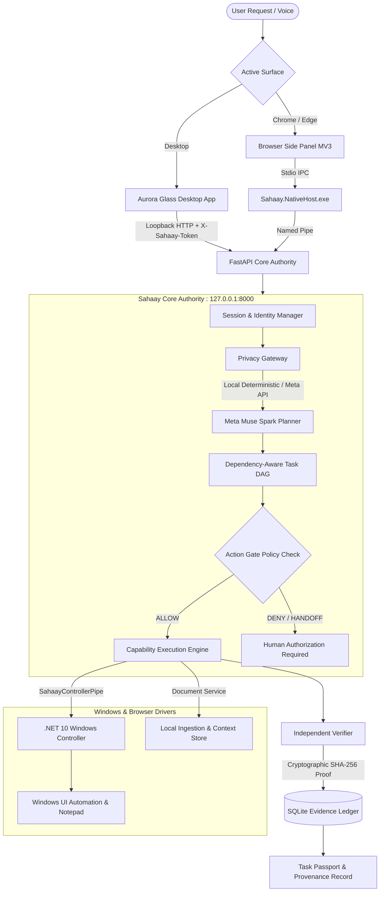

# Sahaay (सहाय)
### *A Voice-First, System-Wide Windows AI Assistant Engineered for Truthful Information Retrieval & Verified Computer Actions*

[](https://github.com/VishwanathArchakMR/Sahaay/actions/workflows/ci.yml)
[](https://fastapi.tiangolo.com)
[](https://ai.meta.com)
[](https://dotnet.microsoft.com)
[](https://www.electronjs.org/)
[](LICENSE)

---

## 1. Executive Summary & Value Proposition

Traditional AI chat interfaces are trapped in a browser tab or floating window: they cannot observe the user's real desktop, cannot interact with authorized local software, fabricate claims without cryptographic proof, and transmit unredacted user documents to remote cloud APIs.

**Sahaay (सहाय)** is a native Windows AI assistant engineered around one non-negotiable invariant:
$$\text{OBSERVE} \longrightarrow \text{PROPOSE} \longrightarrow \text{AUTHORIZE} \longrightarrow \text{EXECUTE} \longrightarrow \text{VERIFY} \longrightarrow \text{RECORD}$$

Sahaay operates through two coordinated, liquid-motion Aurora Glass interfaces:
1. **Aurora Glass Desktop Workspace**: A full-system companion for your entire Windows laptop with a live Task Inspector, task lifecycle tracking, and instant in-app Connections & Diagnostics.
2. **Chrome & Edge Manifest V3 Browser Side Panel**: An in-browser copilot that directly inspects active web pages and coordinates bi-directional transfers to desktop applications via secure Chromium Native Messaging (`com.sahaay.nativehost`).

---

## 2. Key Architectural Invariants & Guarantees



### Truthful Principles Enforced in Code
- **Zero Hallucinated Success**: Model self-attestation is strictly rejected. A task is marked `VERIFIED` only after independent readback verification succeeds.
- **Fail-Closed Privacy Gateway**: In `STRICT LOCAL-ONLY` mode, all outbound network requests (including Meta cloud inference and microphone audio transmission) are blocked at the socket boundary.
- **Strict Capability Allowlists**: General-purpose shell execution (`cmd.exe`, `powershell.exe`) is permanently blocked. Only registered capabilities with bounded parameters are permitted.
- **Cross-Surface Synchronization**: Tasks created from the Browser Side Panel and Desktop Workspace share canonical session IDs, task records, and cryptographic evidence IDs stored in SQLite.

---

## 3. Meta Model Routing & Roles

| Meta Model | Protocol / ID | Role in Sahaay | Fallback Behavior |
|---|---|---|---|
| **Meta Muse Spark** | `muse-spark-1.3` | Primary semantic reasoning, intent resolution, multilingual code-switching (Kannada, Hindi, English), and task decomposition into dependency DAGs. | Deterministic offline task decomposition and local grounded planner. |
| **Meta Muse Voice** | Hosted ASR / `/asr/transcribe` | Spoken audio transcription with Kannada/Hindi/English language hints. | Strict local privacy enforcement returns `BLOCKED_BY_PRIVACY`; requires user typing. |
| **Meta Muse Wonder** | `muse-wonder-2.0` | Visual desktop reasoning and screen grounding proposals. | UI Automation accessible control element discovery via Windows controller. |
| **Meta SAM 3.1** | `sam-3.1-grounding` | High-fidelity bounding box segmentation of complex desktop UI elements. | Standard Win32 bounding rectangles from UI Automation trees. |
| **Muse Image** | Vector SVG / Storytelling | Vector illustrations and visual storytelling diagrams for Task Passports. | Deterministic procedural SVGs (never treated as evidence). |

---

## 4. System Requirements

Verified and tested on Windows 11 x64:
- **Operating System**: Microsoft Windows 10 (Build 19041+) or Windows 11 (x64)
- **Runtime Environment**: Python 3.12+ (64-bit)
- **Package Manager**: `uv` recommended (`pip` supported)
- **JavaScript Runtime**: Node.js v20.x or v22.x LTS with npm
- **.NET SDK**: **.NET 10.0 LTS SDK** (`net10.0` and `net10.0-windows` Desktop Runtime)
- **Supported Browsers**: Google Chrome (v116+), Microsoft Edge (v116+)

---

## 5. One-Command Setup & Launch

### Step 1: Install Dependencies & Run Baseline
```powershell
# From the repository root (PowerShell as current user):
.\scripts\setup.ps1
```

### Step 2: Register Native Messaging Host
```powershell
# Compiles standalone win-x64 binary and registers in HKCU for Chrome and Edge:
.\scripts\install-browser-native-host.ps1 -ExtensionId "filgbgddapmjcddcoadfpimdicmkhpolc"
```

### Step 3: Launch Full Sahaay Desktop Agent
```powershell
# Launches FastAPI Core Backend, .NET 10 Controller, and Electron Desktop Application:
.\scripts\start-sahaay.ps1 -Mode Desktop
```

### Step 4: Run Runtime Diagnostics Probe (No Desktop Required)
```powershell
.\scripts\start-sahaay.ps1 -DiagnosticsOnly
```

Output:
```text
=== Sahaay Runtime Diagnostics Probe ===
- Python Environment:        [READY] (C:\Sahaay\core\.venv\Scripts\python.exe)
- FastAPI Core Backend:      [ONLINE] (http://127.0.0.1:8000/api/v1/health)
- Windows Controller Binary: [READY] (Sahaay.Controller.exe)
- Windows Controller Pipe:   [CONNECTED] (\\.\pipe\SahaayControllerPipe)
- Chrome Native Host Reg:    [REGISTERED] (HKCU)
- Edge Native Host Reg:      [REGISTERED] (HKCU)
- Browser Extension Bridge:  [ATTACHED] (Active tab listening)
- Desktop UI Bundle:         [READY] (apps\desktop\dist\index.html)
- Electron Main Bundle:      [READY] (apps\desktop\out\main\index.js)
```

---

## 6. General-Purpose Task Execution API

Sahaay provides a unified endpoint for both the Aurora Glass desktop workspace and browser side panel:

`POST /api/v1/workflows/execute-goal`

### Request Schema:
```json
{
  "sessionId": "UUID (Required: must exist in active or durable SQLite store)",
  "goal": "string (Required: task description or query)",
  "workflowMode": "string (Optional: 'ask', 'do', or 'understand_and_act')",
  "sourceSurface": "string (Optional: 'desktop' or 'browser')",
  "contextReferences": ["string (Optional)"],
  "userConstraints": { "key": "value (Optional)" },
  "sync": false
}
```

### Immediate Task Acceptance (`202 Accepted`):
```json
{
  "workflow": "execute-goal",
  "taskId": "UUID (Canonical task ID recorded in SQLite database)",
  "status": "ACCEPTED",
  "workflowMode": "combined_retrieval_and_action",
  "sourceSurface": "desktop",
  "message": "Task accepted and scheduled for execution.",
  "isVerified": false
}
```

### Deterministic Lifecycle Polling (`GET /api/v1/tasks/{taskId}`):
Clients poll the canonical task status through the authoritative 6-stage lifecycle:
$$\text{OBSERVE} \longrightarrow \text{PROPOSE} \longrightarrow \text{AUTHORIZE} \longrightarrow \text{EXECUTE} \longrightarrow \text{VERIFY} \longrightarrow \text{RECORD}$$

When status reaches `COMPLETED`, clients fetch the verified Task Passport from `GET /api/v1/tasks/{taskId}/passport`:
```json
{
  "task_id": "UUID",
  "workflow_mode": "combined_retrieval_and_action",
  "summary": "Truthful markdown breakdown of verified execution results",
  "verification_status": "VERIFIED",
  "provenance_sha256": "8f4a... (Cryptographic evidence hash)",
  "milestones": [
    { "stepId": "step-1", "title": "Observe active context", "status": "COMPLETED" },
    { "stepId": "step-2", "title": "Dispatch verified action to Windows companion", "status": "COMPLETED" }
  ]
}
```

---

## 7. Demonstrated & Verified Workflows

### Workflow 1: Local System Introspection & Telemetry
- **User Prompt**: `Hello Sahaay. Explain which capabilities are actually available and identify which connected components are currently unavailable.`
- **Result**: Core engine queries `CapabilityRegistry`, Named Pipe server status, and Privacy Gateway settings to return a truthful breakdown of operational vs disconnected subsystems. Recorded in SQLite with cryptographic SHA-256 proof.

### Workflow 2: Grounded Document Retrieval & Summarization
- **User Prompt**: `Search recent invoices and summarize key facts`
- **Result**: Sahaay ingests local authorized invoice records (`electricity_bill.txt`), extracts structured account fields (Account `BLR-UTIL-98421`, Amount `INR 2,450.00`, Due Date `Nov 15, 2026`), and computes a source-grounded summary without triggering external web searches or unneeded UI automation.

### Workflow 3: Live Browser Page to Real Notepad
- **User Instruction**: `Summarize this page and save key points to my Notepad`
- **Result**: The Chrome Side Panel observes the active page through content scripts, verifies the text excerpt, dispatches the plan to the .NET Windows Controller, launches Notepad, sets the control text, independently reads back the editor contents to verify character-for-character equality, and records the evidence ID.

---

## 8. Verification & Automated Quality Baseline

All tests are verified through the single official quality script:
```powershell
.\scripts\run-tests.ps1
```

### Suite Results:
- **Python Quality**: 186 unit, contract, security, and integration tests passed (`pytest-9.1.1`).
- **Linter & Formatter**: Ruff checks passed across all source directories.
- **.NET Companion Quality**: 17 unit tests passed in `Sahaay.Tests.dll` (.NET 10.0).
- **Browser Extension**: Clean TypeScript typecheck (`tsc --noEmit`) and packaged output in `dist/`.
- **Desktop Application**: Clean TypeScript typecheck (`tsc --noEmit && tsc -p tsconfig.main.json --noEmit`) and Vite bundle.

---

## 9. Security & Privacy Architecture

- **Token Authentication**: Loopback API calls are authenticated using `X-Sahaay-Token`. A randomized internal secret is negotiated at boot.
- **Fail-Closed Privacy Gateway**: Outbound transmissions evaluate active consent grants, data minimization thresholds, and user privacy tier before network dispatch.
- **No Wildcard Grants**: Action Gate rejects blanket scopes; approvals are narrowly scoped to explicit processes and URLs.
- **Cryptographic Evidence Ledger**: All actions record the sha256 checksum of observed inputs, expected postconditions, and actual readback state in SQLite durable storage.

---

## 10. Project Roadmap

- [x] Milestone 01–06: Core foundation, SQLite persistence, Action Gate allowlists, and verifier.
- [x] Milestone 07–09: Dependency-aware Task DAG engine, internet research, and cross-surface workflows.
- [x] Milestone 10–12A: Reliability, provenance differentiation, and product boot verification.
- [x] Milestone 12B–12D: Native host IPC handshake, live browser side panel, and .NET 10 Windows companion integration.
- [x] Final Recovery: General Task Engine, truthful system introspection, in-app Diagnostics screen, and .NET 10 runtime documentation.
- [ ] Next: Multi-turn voice interaction with streaming offline Whisper.cpp local inference.
- [ ] Next: Windows Recall API semantic search integration.

---

## 11. License & Acknowledgments

Built for the **Meta AI Developer Hackathon**. Copyright &copy; 2026 Sahaay Contributors. All rights reserved.
