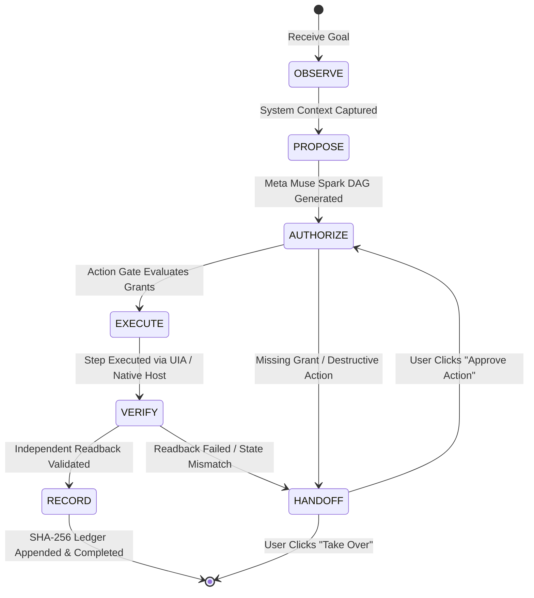

# SAHAAY — COMPUTER-USE EXECUTION CONTRACT

## 1. Principles of Deterministic Execution

Autonomous computer use across desktop applications and web pages is prone to nondeterminism, coordinate drift, and race conditions. Sahaay enforces a formal **Computer-Use Execution Contract** across its Windows and Browser execution tiers.

### Core Invariants:
1. **Accessibility Tree First**: Native UI Automation (UIA) and DOM Accessibility Trees are preferred over blind coordinate clicks.
2. **Snapshot Freshness**: Every interactive browser element must be bound to a unique observation snapshot ID (`@obs-<id>:e<index>`). Navigations or mutations invalidate older snapshots immediately.
3. **No Blind Dispatches**: Actions must specify expected postconditions. An action is considered complete ONLY after postconditions are independently verified.
4. **Zero Wildcard Permissions**: Sensitive desktop and browser mutations require explicit target scoping.

---

## 2. 6-Stage Task Execution Lifecycle

Every task transitions through an authoritative finite state machine managed by the `Orchestrator`:



### Stage Definitions:
1. **OBSERVE**: Inspects active windows, Chromium tab URLs, DOM text, and accessibility trees.
2. **PROPOSE**: Meta Muse Spark 1.3 formulates a typed DAG with atomic capability assignments.
3. **AUTHORIZE**: Action Gate checks active session consent grants. If sensitive and unauthorized, halts for human approval.
4. **EXECUTE**: Dispatches structured parameters to `Sahaay.Controller.exe` or `Sahaay.NativeHost.exe`.
5. **VERIFY**: `IndependentVerifier` queries postcondition state via separate readback query (never trust the driver's exit code alone).
6. **RECORD**: Produces a cryptographically chained SQLite record (`TaskPassport`, `MilestoneCardData`, SHA-256 proof).

---

## 3. Element Addressing Contract (`@obs-` Protocol)

To eliminate the common LLM failure of clicking stale or shifted elements:
- In Chromium tabs, `content.ts` generates a snapshot identifier `obs_<timestamp>_<uuid>` when capturing the accessibility tree.
- Each interactive element is addressed as:
  $$\text{Target} = \text{@obs-}[\text{snapshot-id}]:\text{e}[\text{index}]$$
  *Example*: `@obs-7f8e21:e14`
- When `browser/adapter.py` receives a click or form-fill request:
  - It compares the snapshot ID with `self.latest_observation_id`.
  - If a page navigation, DOM reflow, or new snapshot occurred, the target is rejected with `StaleElementReferenceException`.
  - The orchestrator then requests an adaptive re-observation step.

---

## 4. Windows UI Automation (UIA) Contract

The C# standalone controller (`Sahaay.Controller.exe`) exposes standard Win32 and UI Automation contracts over `\\.\pipe\SahaayControllerPipe`:

### 4.1 Launch Application (`launch_application`)
- **Parameters**: `{"application": "notepad.exe", "arguments": ""}`
- **Execution**: Starts target process; waits for `WaitForInputIdle()`; resolves root `AutomationElement` matching the window class and title.
- **Verification Postcondition**: `GetActiveWindow` returns non-null handle, and `Process.GetProcessesByName(app)` shows active process.

### 4.2 Set Control Text (`set_control_text`)
- **Parameters**: `{"windowTitle": "Notepad", "controlName": "Text editor", "text": "Content"}`
- **Execution**:
  1. Finds target window by title substring.
  2. Traverses UIA control tree to locate matching `EditControl` / `DocumentControl`.
  3. Queries `ValuePattern.SetValue` or `TextPattern`.
  4. If patterns are unavailable (e.g. legacy controls), falls back to `WM_SETTEXT` Win32 message.
- **Verification Postcondition**:
  1. The controller executes a secondary readback: `targetElement.GetCurrentPropertyValue(ValuePattern.ValueProperty)`.
  2. Compares readback string with input string.
  3. Returns `verified: true` only if string content matches.

### 4.3 Click Control (`click_control`)
- **Parameters**: `{"windowTitle": "Notepad", "controlName": "Save", "automationId": "1001"}`
- **Execution**: Invokes `InvokePattern.Invoke()` on target `Button`.
- **Verification Postcondition**: State transition or modal dialog detection.

---

## 5. Independent Verifier Specification

The `IndependentVerifier` class in `core/src/sahaay_core/orchestration/verifier.py` provides non-negotiable verification guarantees:

```python
class IndependentVerifier:
    @classmethod
    def verify_action_outcome(
        cls,
        action: ActionContract,
        execution_result: ExecutionResult,
        observed_postcondition_data: Any,
        is_model_self_attestation: bool = False,
    ) -> VerificationOutcome:
        # Rule 1: Never accept model self-attestation alone
        if is_model_self_attestation:
            return VerificationOutcome(
                status=VerificationStatusEnum.UNVERIFIED,
                confidenceScore=0.0,
                rationale="Model self-attestation cannot prove external world change.",
            )

        # Rule 2: Execution result must be affirmatively true
        if not execution_result.isSuccess:
            return VerificationOutcome(
                status=VerificationStatusEnum.FAILED,
                confidenceScore=0.0,
                rationale="Driver execution reported failure.",
            )

        # Rule 3: Affirmative postcondition readback verification
        # Query UI Automation or DOM for evidence of modification
        # ...
```
This ensures zero false-positive completions across all automated flows.

