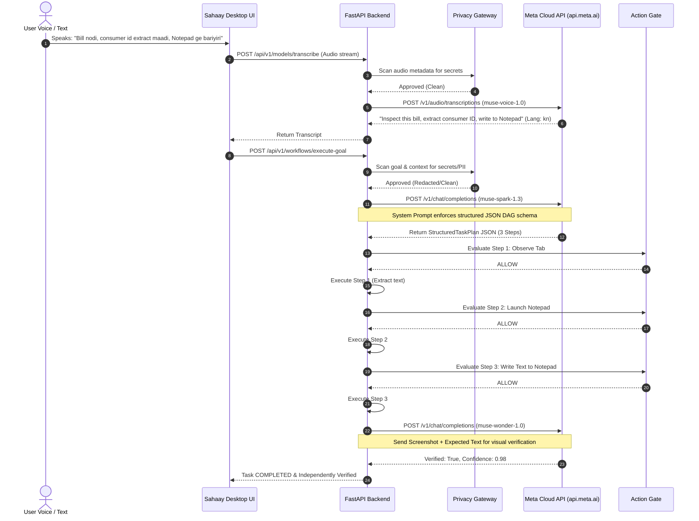

# SAHAAY — META CLOUD MODEL ROUTING SPECIFICATION

## 1. Meta AI Architecture Commitment

Sahaay is built from the ground up as a showcase for **Meta's Cloud AI Ecosystem**.

In strict accordance with the Master Engineering Directive:
- **Zero Local LLM Dependencies**: No reliance on Ollama, LM Studio, vLLM, or heavy local weight runtimes on the user's laptop.
- **Pure Cloud Model Execution**: All complex reasoning, multi-step task planning, speech recognition, and visual verification are routed to Meta Cloud API endpoints.
- **Multilingual Indic Grounding**: Deep native support for Kannada, Hindi, and Indian English code-switched phrases.

---

## 2. Meta Cloud Model Inventory and Allocation Matrix

| Role | Model Identifier | Model Name | Primary Responsibility | Input Modality | Output Modality |
|---|---|---|---|---|---|
| **Semantic Planning & Reasoning** | `muse-spark-1.3` | **Meta Muse Spark 1.3** | High-level goal decomposition, DAG generation, Indic language translation, fact grounding. | Text / Structured JSON | Typed JSON Plan Proposals |
| **Multimodal UI Verification** | `muse-wonder-1.0` | **Meta Muse Wonder 1.0** | Independent visual inspection of desktop and browser screenshots, UI element diffing, anomaly detection. | Image (PNG/JPEG) + Text Prompt | Visual Verification Confidence & Anomaly Report |
| **Streaming Speech-to-Text** | `muse-voice-1.0` | **Meta Voice (SeamlessStreaming / Whisper)** | Continuous low-latency voice capture, multilingual speech recognition with Indic language hints (`kn,hi,en`). | Audio Stream (WebM / WAV) | Normalized Transcript & Detected Language |
| **UI Grounding & Segmentation** | `sam-3.1` | **Meta SAM 3.1 (Segment Anything)** | Zero-shot visual element segmentation, identifying clickable icons and input fields when UIA accessibility trees are sparse. | Window / Screen Bitmap | Bounding Boxes & Centroid Coordinates |

---

## 3. End-to-End Model Invocation Protocols



---

## 4. Model Prompts and JSON Schema Contracts

### 4.1 Muse Spark 1.3 System Prompt Contract
```text
You are Muse Spark 1.3, the principal semantic planning and reasoning model for Sahaay.
Your role is to translate natural language user goals (which may contain Kannada, Hindi, or English code-switching)
into a structured, typed execution Directed Acyclic Graph (DAG) conforming strictly to the StructuredTaskPlan schema.

CRITICAL RULES:
1. Ground all proposed actions strictly in authorized source facts. Never invent citations, URLs, or account numbers.
2. Select atomic capabilities from the authorized registry:
   - browser_tab_observe
   - browser_scroll
   - browser_form_fill
   - windows_launch_app
   - windows_set_control_text
   - windows_inspect_window
   - document_ingest_chunk
   - verify_readback
3. Output MUST be valid, well-formed JSON matching the schema. No markdown prose or preamble outside the JSON object.
```

### 4.2 Muse Spark 1.3 Plan Proposal Schema
```json
{
  "plan_id": "plan-a83f91",
  "task_goal": "Inspect active BESCOM bill and write summary to Notepad",
  "workflow_mode": "cross_context_browser_desktop",
  "steps": [
    {
      "step_id": "step-obs-1",
      "title": "Observe Active Bill Tab",
      "capability": "browser_tab_observe",
      "action_type": "get_tab_content",
      "target_surface": "browser_tab",
      "target_scope": "https://*",
      "preconditions": ["browser_active"],
      "expected_postconditions": ["tab_text_extracted"],
      "parameters": {}
    },
    {
      "step_id": "step-win-2",
      "title": "Launch Windows Notepad",
      "capability": "windows_launch_app",
      "action_type": "launch_application",
      "target_surface": "desktop_window",
      "target_scope": "Notepad",
      "dependencies": ["step-obs-1"],
      "parameters": {"application": "notepad.exe"}
    },
    {
      "step_id": "step-win-3",
      "title": "Populate Bill Data into Notepad",
      "capability": "windows_set_control_text",
      "action_type": "set_control_text",
      "target_surface": "desktop_window",
      "target_scope": "Notepad",
      "dependencies": ["step-win-2"],
      "parameters": {
        "windowTitle": "Notepad",
        "controlName": "Text editor",
        "text": "{{step-obs-1.bill_summary}}"
      }
    }
  ]
}
```

---

## 5. Fail-Closed Privacy & Resilient Fallback Mechanics

1. **Privacy Shield Before Egress**:
   Before sending any prompt, transcript, or screenshot to Meta Cloud, `PrivacyGateway.evaluate_outbound_request()` verifies:
   - Secret Scanner: regex and entropy checks for passwords, JWT tokens, private keys.
   - PII Minimizer: masks credit card numbers and Aadhaar/PAN formats unless explicitly permitted.
   - Mode Verification: if the user activated "Local Mode", outbound transmission is blocked with zero exceptions.

2. **Deterministic Fallback (Zero Hallucination)**:
   If network loss or endpoint outage occurs during a Meta Cloud call:
   - Sahaay NEVER returns fabricated transcripts or synthetic completed task receipts.
   - The system falls back to deterministic local rule engines (`_generate_deterministic_local_plan`) that construct basic DAGs strictly using known registered templates, or returns typed errors (`NOT_CONFIGURED`, `FAILED`) so the user is truthfully informed.
