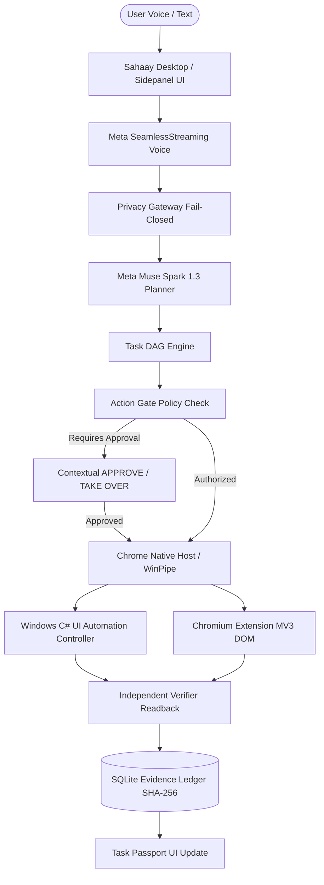

# SAHAAY — REFERENCE IMPLEMENTATION ARCHITECTURAL ANALYSIS

## 1. Executive Summary

To build a competition-grade, voice-first autonomous agent for Windows and Chromium, Sahaay evaluated 10 leading open-source and industry computer-use and browser-automation architectures:

1. **Bytebot** (Computer-use action model & virtual input)
2. **OpenFlux** (Iterative agent loops & reflection)
3. **BagIdea Office** (Enterprise desktop boundary isolation)
4. **Nanobrowser** (Browser-native DOM observation & sidepanel integration)
5. **BrowserOS** (OS-level browser management via CDP)
6. **Vercel Agent Browser** (Declarative browser action execution)
7. **Tencent BrowserSkill** (Structured skill registry & visual grounding)
8. **BrowserAct Skills** (Cross-application translation layer)
9. **Llama Stack Apps** (Meta reference agent architecture & tool calling)
10. **Llama Stack UI** (Agent state visualization & human approval gates)

This document provides a comparative analysis of each reference implementation, identifies their strengths and architectural failure modes, and outlines the precise design patterns adopted by Sahaay.

---

## 2. Comparative Reference Breakdown

### 2.1 Bytebot
- **Architecture**: Linux/macOS containerized agent using vision-based coordinate prediction and synthetic mouse/keyboard dispatch.
- **Strengths**: High generality across legacy software where semantic accessibility trees are incomplete.
- **Weaknesses**: Fragile under display resolution changes, high latency (1–3s per coordinate prediction), susceptible to visual occlusion and coordinate drift.
- **Pattern Adopted in Sahaay**: Sahaay uses **Accessibility Tree First (UI Automation)** via native C# Win32/UIA, falling back to vision coordinates only when controls lack accessible names or identifiers.

### 2.2 OpenFlux
- **Architecture**: Continuous observation-action loop with reflection steps between tool calls.
- **Strengths**: Strong recovery from unexpected modal dialogs or missing elements.
- **Weaknesses**: Unbounded recursion risk; lack of hard postcondition verification leading to hallucinated completion.
- **Pattern Adopted in Sahaay**: Sahaay adopted the **6-Stage Lifecycle** (`Observe -> Propose -> Authorize -> Execute -> Verify -> Record`), but enforces deterministic stop conditions and independent verification before advancing states.

### 2.3 BagIdea Office
- **Architecture**: Enterprise-grade sandboxing for native application execution.
- **Strengths**: Strict boundary enforcement and permission isolation per application.
- **Weaknesses**: Heavyweight virtualization overhead; poor integration with modern web extension runtimes.
- **Pattern Adopted in Sahaay**: Sahaay implements an in-process **Action Gate** that models explicit capability grants per session without requiring VM virtualization overhead.

### 2.4 Nanobrowser
- **Architecture**: Chrome Manifest V3 sidepanel agent communicating directly with active tab DOM via content scripts.
- **Strengths**: Zero latency DOM tree pruning, direct JavaScript execution in tab context, lightweight footprint.
- **Weaknesses**: Sandbox isolation limits it strictly to web pages; cannot touch native desktop applications or the OS shell.
- **Pattern Adopted in Sahaay**: Sahaay's browser extension uses the **Nanobrowser-style MV3 Sidepanel** for UI and DOM pruning, but bridges to the native desktop through a **Native Messaging Host** and FastAPI companion backend.

### 2.5 BrowserOS
- **Architecture**: Deep OS-level integration using the Chrome DevTools Protocol (CDP) over WebSocket.
- **Strengths**: Complete control over network traffic, console logs, and headless page rendering.
- **Weaknesses**: Requires running Chrome with `--remote-debugging-port`, which introduces severe security vulnerabilities if exposed, and conflicts with users' normal browsing sessions.
- **Pattern Adopted in Sahaay**: Sahaay avoids opening unauthenticated debugging ports. Instead, it utilizes standard **Chrome Native Messaging** via stdin/stdout, maintaining enterprise security compliance.

### 2.6 Vercel Agent Browser
- **Architecture**: Declarative, typed actions generated by LLM function-calling schemas.
- **Strengths**: Strict type safety, clean separation of concerns, high serialization efficiency.
- **Weaknesses**: Assumes actions always succeed; minimal postcondition verification logic.
- **Pattern Adopted in Sahaay**: Sahaay adopted **Pydantic/TypeScript contract symmetry** for action proposals (`ActionContract`, `PlanStepProposal`), coupled with an **Independent Verifier** to prove execution.

### 2.7 Tencent BrowserSkill
- **Architecture**: Modally segmented skill catalog mapping high-level user tasks to deterministic procedural subroutines.
- **Strengths**: Eliminates LLM non-determinism for standard tasks like e-commerce checkout or search.
- **Weaknesses**: Inflexible when web applications update their layout or class names.
- **Pattern Adopted in Sahaay**: Sahaay's **CapabilityRegistry** indexes atomic capabilities (`browser_tab_observe`, `windows_launch_app`, `windows_set_control_text`), dynamically assembled into a DAG by Meta Muse Spark.

### 2.8 BrowserAct Skills
- **Architecture**: Cross-application workflow pipeline translating web scraping outputs into desktop office formats.
- **Strengths**: Clean data transformation and tabular data parsing.
- **Weaknesses**: Lack of cryptographic auditability; unverified clipboard transfers.
- **Pattern Adopted in Sahaay**: Sahaay enforces **End-to-End Provenance** tracking with SHA-256 content hashes, recording source URL, timestamp, and target window in an immutable SQLite evidence ledger.

### 2.9 Llama Stack Apps
- **Architecture**: Meta's modular reference implementation for Llama models, unifying inference, tool execution, and vector memory.
- **Strengths**: Direct model-level tool calling, standard client protocols, high throughput with Meta Cloud endpoints.
- **Weaknesses**: Primarily targeted at Linux server deployments; lacks native Windows desktop automation primitives.
- **Pattern Adopted in Sahaay**: Sahaay directly models its cloud inference client (`MetaClient`) on Llama Stack conventions, connecting to Meta's Cloud API for Muse Spark 1.3, Muse Wonder 1.0, and SeamlessStreaming Voice.

### 2.10 Llama Stack UI
- **Architecture**: Web-based conversational and agentic workflow dashboard featuring human-in-the-loop authorization cards.
- **Strengths**: Clean visualization of multi-step tool calls and policy handoffs.
- **Weaknesses**: Complex multi-service orchestration required for simple desktop tasks.
- **Pattern Adopted in Sahaay**: Sahaay's **Aurora Glass UI** adapts Llama Stack UI's human-in-the-loop approval paradigm into the contextual **APPROVE / TAKE OVER** control, activating seamlessly whenever the Action Gate encounters sensitive operations.

---

## 3. Summary of Sahaay's Synthesized Architecture

