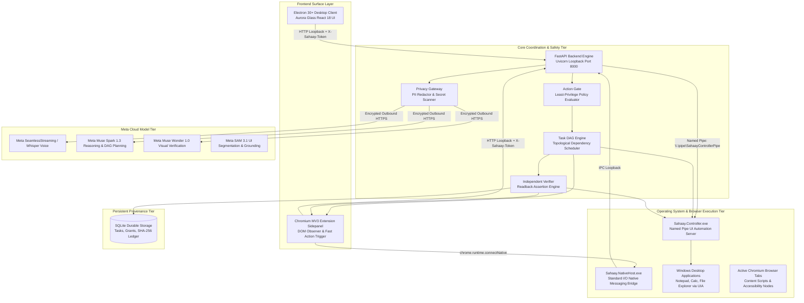
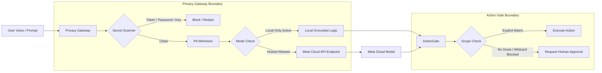

# SAHAAY — TARGET RUNTIME ARCHITECTURE SPECIFICATION

## 1. System Topology Overview

Sahaay operates as a distributed, high-performance, local-loopback multi-process system engineered specifically for Windows 10/11 and Chromium-based browsers (Chrome / Edge).

---

## 2. Core Subsystems and IPC Contracts

### 2.1 Electron Desktop Client
- **Runtime**: Electron 30.x with Node 20+ and Chromium.
- **Frontend Framework**: React 18 with TypeScript and Vite.
- **Visual Design**: Liquid Flow Aurora Glass aesthetic (translucent glassmorphism, dynamic glow gradients, responsive typography).
- **Communication**: Interacts with FastAPI backend via authenticated HTTP loopback (`http://127.0.0.1:8000/api/v1`) using bearer pairing tokens passed via Electron preload scripts.

### 2.2 Chromium MV3 Extension
- **Manifest Version**: Manifest V3 compliant.
- **Components**:
  - `background.ts`: Service worker managing extension lifecycle and native messaging port connections.
  - `sidepanel.ts`: Interactive HTML5 sidebar providing in-browser assistance without covering page content.
  - `content.ts`: Injected script extracting visible text, semantic accessibility trees, and form inputs.
- **Security**: Strict Content Security Policy (`script-src 'self'`), zero inline script handlers, zero eval.

### 2.3 FastAPI Core Backend
- **Framework**: FastAPI (Python 3.11/3.12) running under Uvicorn on `127.0.0.1:8000`.
- **Role**: Central coordinator managing session lifecycles, capability registries, task state machines, model routing, and persistent evidence ledgers.
- **Security**: CORS restricted to loopback origins and authorized extension IDs; request token verification middleware on all endpoints except health probes.

### 2.4 C# Windows UI Automation Controller (`Sahaay.Controller.exe`)
- **Technology**: .NET 8 / C# Windows Desktop Runtime.
- **IPC Protocol**: Windows Named Pipe: `\\.\pipe\SahaayControllerPipe`.
- **Capabilities**:
  - `LaunchApplication`: Process start and window handle resolution.
  - `SetControlText`: Direct UI Automation `ValuePattern` / `TextPattern` invocation without clipboard hijacking.
  - `ClickControl`: `InvokePattern` / physical coordinate click simulation.
  - `GetActiveWindow` / `InspectTree`: Accessible tree traversal and control hierarchy enumeration.
- **Performance**: Sub-5ms response time over duplex named pipe with length-prefixed JSON messaging.

### 2.5 Chrome Native Messaging Host (`Sahaay.NativeHost.exe`)
- **Technology**: .NET 8 console application implementing Chrome Native Messaging standard I/O protocol (32-bit little-endian message length prefix followed by UTF-8 JSON).
- **Registration**: Registered in `HKCU\Software\Google\Chrome\NativeMessagingHosts\com.sahaay.nativehost`.
- **Bridge Function**: Connects Chrome extensions directly to Sahaay backend without requiring WebSocket servers or open TCP ports.

---

## 3. Security and Privacy Boundaries

### 3.1 Privacy Gateway (Fail-Closed Default)
- Scans all outbound prompts and contextual facts for secrets, API tokens, passwords, private keys, and high-sensitivity PII before network transmission.
- Evaluates `local_only_mode`. When enabled, blocks all outbound traffic immediately and routes requests to deterministic local planning routines.

### 3.2 Action Gate (Zero-Wildcard Authorization)
- Every proposed execution step must obtain an affirmative `ALLOW` policy decision from `ActionGate.evaluate()`.
- Prohibits wildcard (`*`) capability grants for destructive actions.
- Scopes are matched against exact application names (e.g. `Notepad`) or specific URL origins.
- Unmatched actions transition the task to `HANDOFF_REQUESTED`, surfacing the **APPROVE / TAKE OVER** controls in the user interface.

### 3.3 Independent Verification & Cryptographic Ledger
- Sahaay strictly decouples action execution from action verification.
- An action is never assumed successful based on the model's self-attestation or driver return code alone.
- The `IndependentVerifier` reads back postcondition state (e.g., querying the active Notepad text box via UI Automation `ValuePattern` to verify the written content matches the extracted text).
- Verified results are serialized, hashed (SHA-256), and appended to the immutable SQLite ledger (`sahaay.db`).

